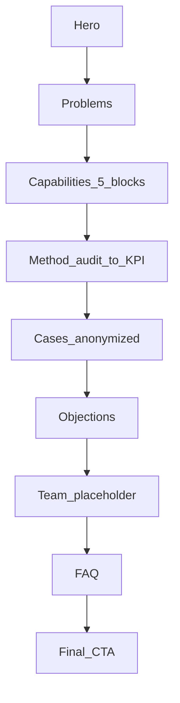

# Спецификация правок лендинга AgencyLanding

Документ для агента-исполнителя. Менять только то, что указано. Копирайт в секциях — брать из этой спеки, не импровизировать AI-хайп и маркетинг.

## Зафиксированные решения (grill)

- Маркетинг: полностью вырезать с главной + **удалить** [`marketing.html`](marketing.html)
- `#operations`: заменить каталог AI-ролей/табы на **5 блоков экспертизы** (без табов)
- CTA: все primary-кнопки → `https://t.me/kenig_web` (открывать в новой вкладке, `rel="noopener noreferrer"`)
- [`closed-contour.html`](closed-contour.html): оставить отдельной витриной услуги; вычистить ссылки на маркетинг; включить Telegram-CTA
- В блоке «цепочки цифровых сотрудников» — акцент на **ПДн + модели в РФ-контуре** + ссылка на closed-contour
- Hero:
  - eyebrow: `Внедряем технологии с умом`
  - H1 line1: `СНАЧАЛА ПРОЦЕСС`
  - H1 line2: `ПОТОМ АВТОМАТИЗАЦИЯ`
- Кейсы: 3–5 обезличенных типовых сценариев **без выдуманных цифр клиентов**
- Команда: оставить placeholder

## Файлы в scope

| Файл | Действие |
|---|---|
| [`index.html`](index.html) | Основная перепись секций, meta, nav, CTA, удаление маркетинга |
| [`closed-contour.html`](closed-contour.html) | Убрать маркетинг из nav/footer; CTA → Telegram; якоря на главную обновить (`#operations` → новый смысл) |
| [`marketing.html`](marketing.html) | **Удалить файл** |
| [`components/agent-tabs.js`](components/agent-tabs.js) | Убрать `<script>` из `index.html`; файл можно оставить на диске |
| CSS ([`apple-design.css`](apple-design.css) и др.) | Минимально: стили для 5 capability-карточек на базе существующих `.agent` / `.feature-card` / grid; не делать редизайн |

Не трогать: 3D hero (`hero-3d.js`), motion/reveal, brand «АВТОМАТИЗАЦИЯ / агентство», общую визуальную систему.

## Целевой порядок секций на `index.html`



**Удалить целиком:**
- bridge «те же правила для бренда»
- `#marketing` и следующую секцию «Примеры маркетинговых ролей»
- все ссылки/упоминания маркетинга, `marketing.html`, «ИИ-реальность», «потом агенты» как promise
- tablist + все `ops-panel-*` с ролями внутри `#operations`

**Перенумеровать** eyebrow секций после удаления маркетинга (01…N по факту).

---

## 1. Meta / head

- `title`: `Сначала процесс — потом автоматизация | Автоматизация процессов`
- `description`: `Цифровое упорядочивание операционных процессов: аудит as-is, карта автоматизации, baseline и KPI до внедрения. ИИ и интеграции — инструменты, не обещание.`
- Удалить `<script src="components/agent-tabs.js" defer></script>`

## 2. Header / mobile nav / footer

Nav (desktop + mobile), без маркетинга:

1. `#method` — Как работаем  
2. `#operations` — Компетенции (или «Что делаем»; label на выбор агента, якорь `#operations` сохранить)  
3. `closed-contour.html` — Закрытый контур  
4. `#cases` — Кейсы  
5. `#team` — Команда  
6. `#faq` — FAQ  

Header CTA: заменить `button[disabled]` на ссылку-кнопку:

```html
<a class="header-cta" href="https://t.me/kenig_web" target="_blank" rel="noopener noreferrer">Написать в Telegram ↗</a>
```

Footer: убрать «Маркетинг ↗»; оставить Закрытый контур + Как работаем.

То же для nav/footer/`header-cta` в [`closed-contour.html`](closed-contour.html). Удалить любые `marketing.html`.

## 3. Hero (`#top`)

**Точные тексты:**

- eyebrow: `Внедряем технологии с умом`
- H1: `СНАЧАЛА ПРОЦЕСС` + `ПОТОМ АВТОМАТИЗАЦИЯ` (вторая строка с классом `dim`, как сейчас)
- lead: `Строим цифровые процессы, которые ускоряют операционку. Не начинаем без аудита текущего состояния: карта автоматизации, замер качества и скорости as-is, целевые KPI — и только потом внедрение.`
- CTA: ссылка `Заказать аудит процессов ↗` → `https://t.me/kenig_web` (класс `button button-light rise`, не disabled)
- hero-bottom span: `СНАЧАЛА ПОРЯДОК. ПОТОМ СКОРОСТЬ.`

Запрещено в hero: маркетинг, «агенты» как promise, «ИИ-реальность».

## 4. Problems (`#problems`)

Сохранить сетку из 4 карточек + блок «НАША ПОЗИЦИЯ». Переписать содержимое:

| # | Заголовок | Текст |
|---|---|---|
| 01 / СКОРОСТЬ | Клиент ждёт КП днями — пока правила и данные размазаны по людям и таблицам. |
| 02 / ШТАТ | Выручка растёт, а ФОТ обгоняет её: ручные операции масштабируются наймом. |
| 03 / ПРАВИЛА | Одинаковая логика в Excel и мессенджерах даёт разный результат у разных сотрудников. |
| 04 / КОНТРОЛЬ | Нет baseline: непонятно, сколько длится процесс, где ломается качество и какой KPI считать успехом. |

Позиция: `Мы не продаём «внедрить ИИ». Мы упорядочиваем операционные процессы: аудит as-is → карта → KPI → внедрение. Технологии (включая ИИ, интеграции, сайты) — средства, не цель.`

H2 секции можно оставить близким к текущему или заменить на: `Хаос в процессах не виден в отчётах.` / `Но съедает маржу.`

## 5. Capabilities — заменить `#operations`

**Удалить:** tablist, все панели ролей, ссылку «ИИ внутри периметра» в текущей формулировке.

**Секция:** `id="operations"` сохранить.

- eyebrow: `02 / КОМПЕТЕНЦИИ` (номер скорректировать по порядку)
- H2: `Что упорядочиваем` / `и чем закрываем`
- intro: `Пять направлений экспертизы. ИИ — один из инструментов. Старт всегда с аудита процессов и карты автоматизации.`

**5 блоков** (карточки на существующих паттернах `.agent` или аналог; без табов; сетка 1→2→3 колонки по брейкпоинтам):

### Блок 1 — Цепочки цифровых сотрудников
- Заголовок: `Цепочки цифровых сотрудников`
- Текст: `Выстраиваем связанные цифровые роли под реальный процесс: от заявки до исполнения с правами, лимитами и журналом действий — не набор разрозненных ботов.`
- **Обязательный акцент безопасности:** `При работе с ПДн проектируем контур с учётом требований к обработке персональных данных: модели и обработка — в российском контуре.`
- Ссылка: `Подробнее о закрытом контуре ↗` → `closed-contour.html`

### Блок 2 — Правила из таблиц → модули
- Заголовок: `Правила расчётов — в код`
- Текст: `Собираем разрозненные правила из таблиц и голов сотрудников в программируемые модули с воспроизводимым результатом.`

### Блок 3 — CRM под требования
- Заголовок: `CRM и интеграции под ваш контур`
- Текст: `Встраиваем CRM и внешние системы под фактические процессы компании, а не под «коробочный» сценарий.`

### Блок 4 — RAG / память знаний
- Заголовок: `Память знаний компании`
- Текст: `Собираем регламенты, решения и инструкции в управляемый слой знаний (в т.ч. RAG), чтобы ответы и действия опирались на ваши правила.`

### Блок 5 — Сложные сайты под ключ
- Заголовок: `Сайты и админ-контуры любой сложности`
- Текст: `Разрабатываем сайты под ключ: сложные административные модули, интеграции с CRM и внешними сервисами.`

Внизу секции одна ссылка: `Как устроен метод: аудит → карта → KPI ↗` → `#method`

## 6. Method (`#method`)

- H2: `Сначала процесс —` / `потом автоматизация.`
- intro: `Не начинаем работу без аудита текущего состояния. До внедрения фиксируем baseline и целевые KPI.`

**5 шагов timeline** (иконки/разметку сохранить, тексты заменить):

1. **Аудит процессов** — `Фиксируем as-is: участники, шаги, правила, системы, узкие места. Без аудита к карте не переходим.` / срок: `СРОК СОГЛАСУЕМ`
2. **Карта автоматизации** — `2–3 недели: приоритеты, контуры, рекомендация по архитектуре, план на 3–6 месяцев.` Убрать «включая маркетинг» из bullet-списка. Оставить note про фиксированную цену и зачёт в пилот.
3. **Baseline и KPI** — `Замеряем качество и скорость as-is. Согласуем целевые KPI, к которым должна прийти организация после внедрения.`
4. **Пилот одного контура** — `Внедряем один приоритетный контур и сверяем факт с KPI.`
5. **Масштаб и сопровождение** — `Подключаем следующие процессы по карте; документация, обучение, сопровождение.`

(Если удобнее слить 5→4 шага в вёрстке — допустимо объединить 4+5, но **аудит, карта, baseline/KPI, пилот** обязательны как отдельные смысловые этапы.)

## 7. Cases (`#cases`)

Убрать pending «маркетинговые кейсы».

- eyebrow/H2: оставить смысл «результат в часах и деньгах» или `Типовые сценарии` / `без выдуманных цифр`
- intro: `Обезличенные сценарии из практики. Конкретные метрики клиента публикуем только с подтверждением.`

**5 карточек-сценариев** (структура: Задача → Что сделали → Что измеряем; **без процентов/рублей «как у клиента»**):

1. Цепочка цифровых сотрудников в операционке (+ упоминание РФ-контура/ПДн где уместно)
2. Правила расчётов из таблиц → модуль
3. CRM-интеграция под процесс компании
4. RAG / память знаний для регламентов
5. Сложный сайт с админкой и интеграциями

## 8. Objections

Переписать акцент с «ИИ ошибается» на process-first. Состав:

1. Не понимаем, с чего начать → аудит + карта (цена/срок фиксируются)
2. Окупится ли → KPI и окупаемость до внедрения; если не сходится — скажем до старта
3. Данные / ПДн → закрытый контур, NDA, РФ-контур; ссылка на `closed-contour.html`
4. Зачем обязательный аудит → без as-is автоматизируем хаос
5. Зависимость от подрядчика → артефакты и знания остаются у клиента
6. Кто поддерживает → сопровождение/документация/обучение

Убрать формулировки, где «агент» = ядро оффера.

## 9. Team (`#team`)

Оставить placeholder без изменений по смыслу (без маркетинга).

## 10. FAQ (`#faq`)

Удалить вопрос «Карта включает маркетинг?».

Оставить/добавить:

1. Сколько стоит карта автоматизации? — как сейчас (фикс + зачёт в пилот)
2. Нужно ли заранее выбирать процессы? — нет, на карте
3. Почему без аудита не работаете? — иначе нет baseline и KPI
4. Делаете ли сайты отдельно от автоматизации? — да, под ключ, в т.ч. сложные админки и CRM
5. Что с ПДн и моделями? — требования к обработке ПДн; модели в РФ-контуре; детали на closed-contour

## 11. Final CTA

- H2 согласовать с hero: `СНАЧАЛА ПРОЦЕСС.` / `ПОТОМ АВТОМАТИЗАЦИЯ.` или `СНАЧАЛА ПЛАН И ЦИФРЫ.` / `ПОТОМ ВНЕДРЕНИЕ.` (допустимо второе — про метод)
- Кнопка: `Заказать аудит процессов ↗` → Telegram
- Risk line: `Если автоматизация не окупится, скажем об этом до начала работ.`
- Next steps: `Ответ в рабочий день → аудит/знакомство → предложение по карте автоматизации.`

## 12. `closed-contour.html` (минимальный патч)

- Вычистить маркетинг из header/footer
- CTA → `https://t.me/kenig_web`
- Nav: ссылка на компетенции главной `index.html#operations`
- Контент страницы как витрину услуги **не переписывать с нуля** в этой итерации; достаточно согласованности ссылок/CTA. Если в тексте есть «маркетинг» — удалить точечно.

## 13. Acceptance criteria

- Поиск по репо: нет `marketing.html`, нет видимого «Маркетинг»/«ДНК бренда»/«маркетингов» на `index.html` и `closed-contour.html`
- Нет H1/title про «агентов» как promise; hero = зафиксированная связка
- Нет tablist/ролей-каталога в `#operations`; есть ровно 5 блоков экспертизы
- В блоке цифровых сотрудников явно: ПДн + модели в РФ-контуре + link на closed-contour
- Все бывшие disabled primary CTA кликабельны на `t.me/kenig_web`
- Method содержит аудит → карта → baseline/KPI → пилот → масштаб
- Кейсы без выдуманных метрик клиентов; команда-placeholder на месте
- Страница читаема desktop/mobile; существующие reveal/3D не сломаны
- Агент **не** добавляет маркетинговую автоматизацию «на будущее»

## Вне scope этой итерации

- Редизайн, смена бренд-имени, реальные фото команды, подтверждённые клиентские цифры
- Полный рерайт copy `closed-contour.html`
- Новые зависимости/сборка
